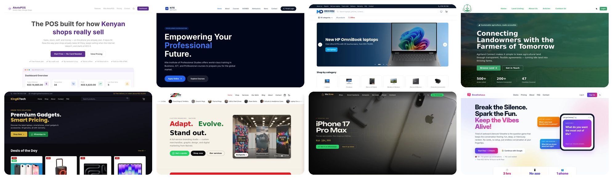

# Hi, I'm Endrex Akoto 👋

Full-stack software engineer and founder of
[Akoto Group Limited](https://akotogrouplimited.com/). I build software that
small and mid-sized organisations in Kenya actually run on: school management,
point of sale, payroll, ERP, IoT installations, AI assistants and the websites
and stores that sit in front of them.

## 🏆 Highlights

| | |
|---|---|
| 🏫 | **Akoto Shule** in schools: fees, M-Pesa, CBC reports and payroll in one system |
| 🧾 | **AkotoPOS** live for shops and small businesses, with M-Pesa built in |
| 🌍 | **Nine Kenyan client sites live**, from a training institute to an AgriTech marketplace |
| 🇺🇸 | **US events industry**: Assistie, Intensity AI and The Hook Club, web and iOS |
| 📱 | The Akoto staff portal shipped to **Google Play** as a progressive web app |
| 🤖 | **Claude-powered assistants** inside the products, with the key kept server-side |
| 💳 | **Payments end to end**: M-Pesa, IntaSend, Paystack, Stripe and PayPal, multi-currency, with signed e-contracts and audit trails |
| 📡 | **IoT** for fish farms, greenhouses and BnB door access |

## 🛠️ Stack

- **Backend**: Python with Flask and Django, SQLAlchemy, MariaDB and Postgres,
  REST APIs, cron-driven background jobs.
- **Frontend**: TypeScript, React, Next.js, Tailwind CSS, Vite; progressive web
  apps shipped to Android as trusted web activities.
- **Mobile**: Flutter and Dart.
- **AI**: Claude-powered assistants inside the products I ship, with the
  provider key kept server-side and the model chosen by capability tier.
- **IoT**: sensors, controllers and gateways reporting into web dashboards
  with alerts.
- **Payments**: M-Pesa (STK push, C2B callbacks), IntaSend, Paystack, Stripe
  and PayPal, in KES and USD, with idempotent callbacks and reconciliation.
- **Integrations**: Meta Graph API, Linear, Web Push, email (SMTP, IMAP, SES).
- **Operations**: cPanel and LiteSpeed hosting, Cloudflare Pages, Docker for
  local work, integration tests that mock below the network boundary.

I care about the unglamorous parts: idempotent payment callbacks, audit
trails on signed documents, statutory deductions that are right to the
shilling, and outreach systems that respect sending limits.

## 🚀 Products

- 🏢 **[Akoto Group](https://akotogrouplimited.com/)**: the company site with a
  Claude-powered assistant, and behind it the staff portal: CRM, invoicing,
  e-signing, payroll, multi-currency finance and outreach, installed on phones
  as a PWA and on Google Play.
- 🏫 **[Akoto Shule](https://akotoshule.link/)**: school management for Kenyan
  schools, from fees and M-Pesa payments to CBC reporting and payroll.
- 🧾 **[AkotoPOS](https://akotopos.co.ke/)**: point of sale and stock control for
  shops and small businesses, with M-Pesa built in.
- 🎓 **[Akoto Learn](https://akotolearn.co.ke/)**: coding, robotics and AI courses
  for Kenyan learners, with a short-course school behind it.

## 🇺🇸 Apps and platforms for the US events industry

- 🤝 **[Assistie](https://assistie.com/)**: event staff, booked in minutes. Planners
  list the help they need for a wedding, gala or conference; assistants show
  their skills, rates and availability and accept with one tap. Web app at
  [app.assistie.com](https://app.assistie.com/) plus an iOS app, with messaging,
  reminders and reviews.
- 🎸 **[Intensity AI](https://www.in10cityband.com/)**: the operations platform and
  mobile app for a live entertainment company: gig invites answered in a tap,
  run of show, rosters, set lists with each musician's parts, venue and load-in
  details, blackout dates and pay history, all fed from the office's booking,
  staffing and song-library system.
- 🎤 **[The Hook Club](https://thehookclub.nyc/)**: official site for a New York live
  entertainment collective of wedding bands, DJ ensembles and live performers.

## 🌐 Client work that is live

| Site | What it does |
|---|---|
| 🎓 [Kite Institute of Professional Studies](https://kiteinstituteofprofessionalstudies.com/) | Academic platform for a KASNEB, IT and business training institute, with online applications |
| 🏫 [St. Monica's Girls' Senior School, Kitale](https://stmonicasgirlskitale.sc.ke/) | School website with admissions, a fee structure published by year, news and downloads, kept current by school staff through their own admin |
| 🔎 [Nexa Research](https://nexagroupke.com/) | Site for a Nairobi research and public-data intelligence firm: services, research write-ups and insights, with enquiries landing in the firm's own inbox |
| 💻 [Mich Digi Solutions](https://michdigisolutions.com/) | Online store for a computer and electronics retailer, with WhatsApp and call enquiry |
| 📱 [KingBi Tech Solutions](https://www.kingbitechsolutions.com/) | Gadgets marketplace with smart pricing |
| 🎨 [Mkenya2RU Creatives](https://mkenya2ru.com/) | Branding and merchandise storefront with WhatsApp ordering |
| 🌱 [Agriland Connect](https://agrilandconnect.com/) | AgriTech marketplace linking smallholder farmers with suppliers and buyers |
| 🔧 [We Drop Technologies](https://wedroptech.com/) | ICT solutions company: laptops, refurbished machines and repairs |
| 🎲 [Breathehaus](https://breathehaus.com/) | Browser-based conversation game for dates, friends and team nights |

## 🔒 Other systems I have built

These are private client or internal repositories, so there is nothing to
link, but they are the bulk of the work:

- 🏭 **ERP, HRM and payroll**: custom builds for companies with large payrolls
  and stock, with Kenyan statutory deductions (PAYE, NSSF, SHIF, Housing
  Levy) done per person.
- 🗂️ **Management systems**: hospital, chama (savings group), rental, hotel and
  BnB, loan, tourism and ISP data retail.
- 📡 **IoT**: sensor and control systems for fish farming, greenhouses, and
  BnB door access and room sensors, with dashboards and alerts on top.
- 🧠 **AI for companies**: training and building models on a company's own
  data, and assistants wired into the systems staff already use.
- 💰 **Finance**: invoicing, a wallet with QR payments, and an investor portal
  (Mwekezaji).
- 🛒 **E-commerce**: auto parts (Deutsche Point), beauty and lifestyle stores.
- 📣 **Marketing and content**: social media marketing automation, a growth
  engine, a document generator (Doc Forge).
- 🩺 **Health**: AfyaLink and a telemedicine front end.
- 📊 **Data**: sentiment analysis in Python notebooks.

## 🤝 Services

Beyond the products, Akoto Group takes on general technology work for
companies: custom software, ERP and HRM implementation, IoT installations,
AI model training and integration, hosting and infrastructure, digital
marketing, and staff training so teams can run what we hand over. If it is a
technology problem a Kenyan business has, we will usually take it on.

## 📂 Public projects

Older projects, experiments and course work.

| Project | Stack | What it is |
|---|---|---|
| [portfolio](https://github.com/EndrexAkoto/portfolio) | JavaScript | Personal portfolio site |
| [Healthcare_Appointment_Scheduling_System](https://github.com/EndrexAkoto/Healthcare_Appointment_Scheduling_System) | Python | Appointment booking for clinics |
| [Telemedicine-](https://github.com/EndrexAkoto/Telemedicine-) | HTML | Telemedicine front end |
| [SkillHive](https://github.com/EndrexAkoto/SkillHive) | CSS | Skills marketplace concept |
| [Traffic_Violation_Reporting_System](https://github.com/EndrexAkoto/Traffic_Violation_Reporting_System) | Dart | Flutter app for reporting traffic violations |
| [weather_application](https://github.com/EndrexAkoto/weather_application) | Python | Weather lookup app |
| [Wardrobe-Management-System](https://github.com/EndrexAkoto/Wardrobe-Management-System) | Laravel | Wardrobe inventory manager |
| [-SUI_BootCamp_Calculator](https://github.com/EndrexAkoto/-SUI_BootCamp_Calculator) | Move | Sui bootcamp exercise |

## 📬 Contact

- 🌐 [akotogrouplimited.com](https://akotogrouplimited.com/)
- ✉️ hello@akotogrouplimited.com

